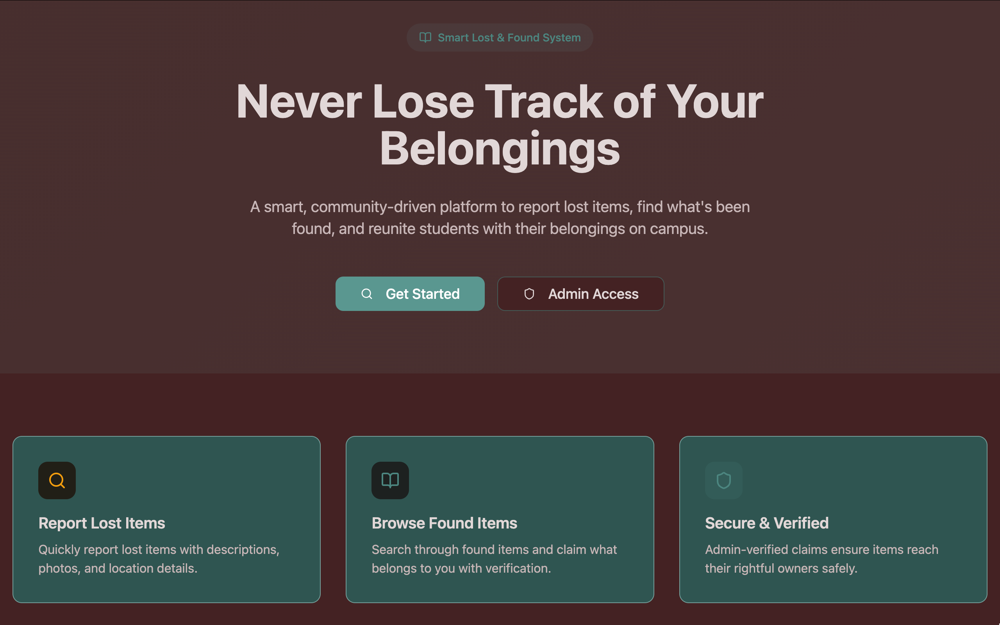
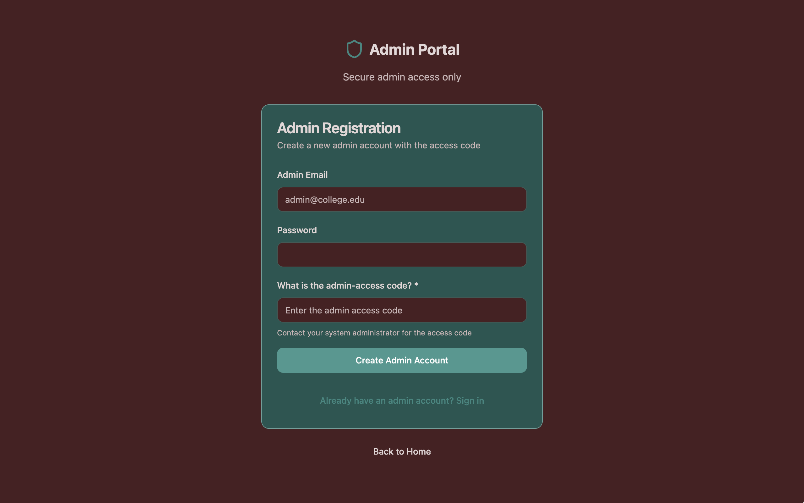
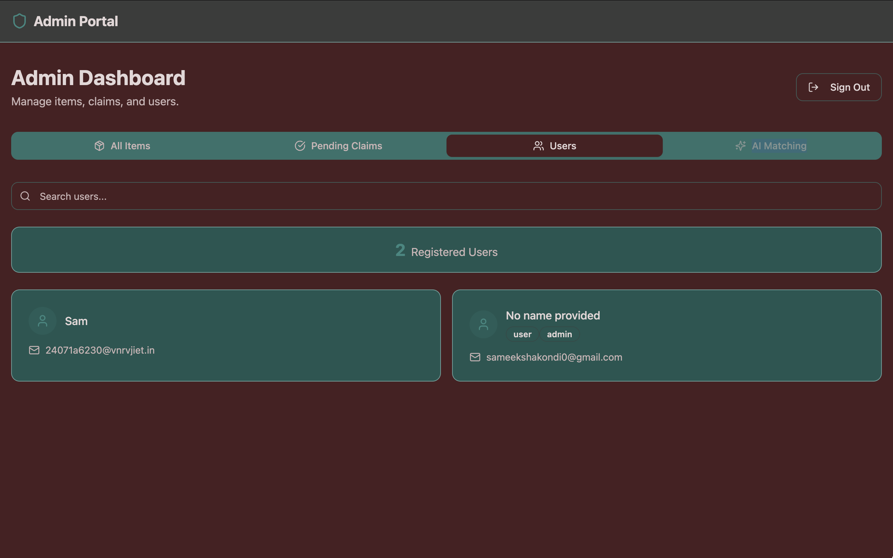
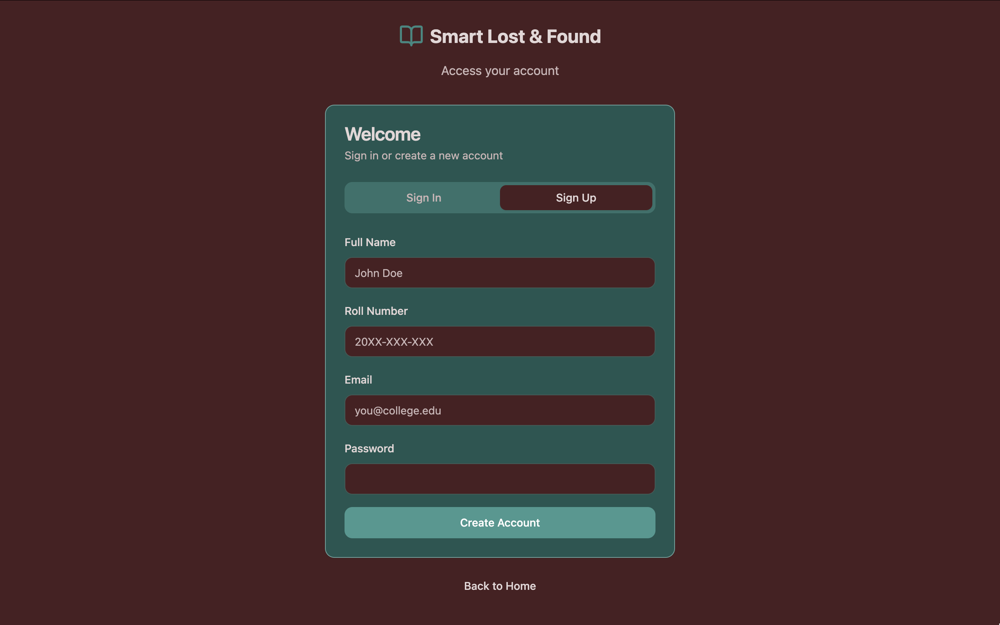
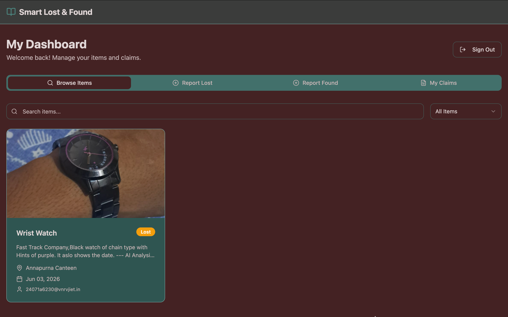
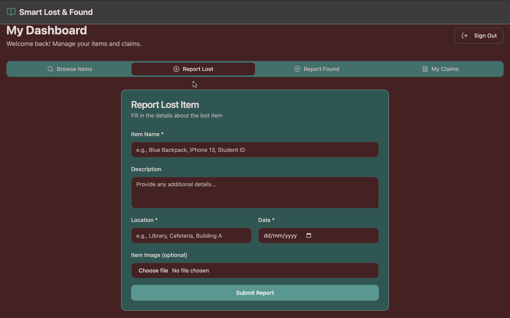

# 🎒 Smart Lost & Found System
🚀 A modern campus recovery system with secure claims, admin verification, and real-time tracking.


> Helping students reconnect with their lost belongings.

A secure campus-focused Lost & Found platform that enables users to report lost items, browse found items, and recover belongings through a verified ownership claim workflow. Built with authentication, role-based access control, and secure database policies to ensure trusted item recovery.

---

## 📸 Application Preview

<table>
  <tr>
    <td></td>
    <td></td>
  </tr>
  <tr>
    <td></td>
    <td></td>    
  </tr>
  <tr>
    <td></td>
    <td></td>
  </tr>
</table>

---
## 🌐 Live Demo

🚀 Try the app here:  
👉 https://smart-lostfound.lovable.app


## 🚀 Features

### 📦 Lost & Found Management

* Report lost and found items
* Upload item images and descriptions
* Track item status
* Browse available listings

### 🔍 Search & Discovery

* Browse found items
* Search and filter listings
* View item details and recovery status

### ✅ Ownership Claim Workflow

* Submit ownership claims
* Verification-based recovery process
* Claim tracking and status updates
* Administrative approval workflow

### 🔐 Authentication & Access Control

* Secure user authentication
* Protected routes
* Role-based administrator access
* Server-side authorization checks

### 📱 Responsive User Experience

* Mobile-friendly design
* Modern and intuitive interface
* Optimized for desktop and mobile devices

---

## ⚡ Technical Highlights

* Full-stack React + Supabase application
* Role-Based Access Control (RBAC)
* Row-Level Security (RLS) policies
* Secure image storage and retrieval
* Form validation using Zod
* Real-time data synchronization using TanStack Query
* Responsive UI built with Tailwind CSS and shadcn/ui

---

## 🛠️ Tech Stack

| Category         | Technology            |
| ---------------- | --------------------- |
| Frontend         | React 18              |
| Language         | TypeScript            |
| Build Tool       | Vite                  |
| Styling          | Tailwind CSS          |
| UI Components    | shadcn/ui             |
| Backend          | Supabase              |
| Database         | PostgreSQL            |
| Authentication   | Supabase Auth         |
| State Management | TanStack Query        |
| Validation       | React Hook Form + Zod |

---

## 🏗️ Architecture

```text
Users
   │
   ▼
Authentication Layer
   │
   ▼
Lost & Found Portal
   │
   ├── Report Items
   ├── Browse Listings
   └── Submit Claims
            │
            ▼
    Admin Verification
            │
            ▼
      Item Recovery
```

---

## 🎯 Why I Built This

Students frequently lose personal belongings on campus, while existing recovery processes are often informal and inefficient.

I built Smart Lost & Found System to provide a centralized platform where lost and found items can be reported, searched, and verified securely. The project also gave me hands-on experience with authentication, access control, database security, and full-stack application development.

---

## 📦 Installation

### Clone Repository

```bash
git clone <https://github.com/sameeksha708/smart-lostfound.git>
cd smart-lostfound
```

### Install Dependencies

```bash
npm install
```

### Start Development Server

```bash
npm run dev
```

Application runs at:

```text
http://localhost:5173
```

---

## 🔮 Roadmap

* AI-powered image matching
* Email notifications
* In-app messaging
* Advanced search filters
* QR-code based item claiming
* Analytics dashboard

---

## 📚 Learning Outcomes

This project helped me explore:

* Full-Stack Web Development
* Authentication & Authorization
* Database Security
* Role-Based Access Control (RBAC)
* Row-Level Security (RLS)
* CRUD Operations
* Responsive UI Development
* Real-World Problem Solving

---

## 👩‍💻 Author

**Sameeksha Kondi**

* GitHub: https://github.com/sameeksha708
* LinkedIn: https://www.linkedin.com/in/sameekshakondi/

---

## 📄 License

MIT License
